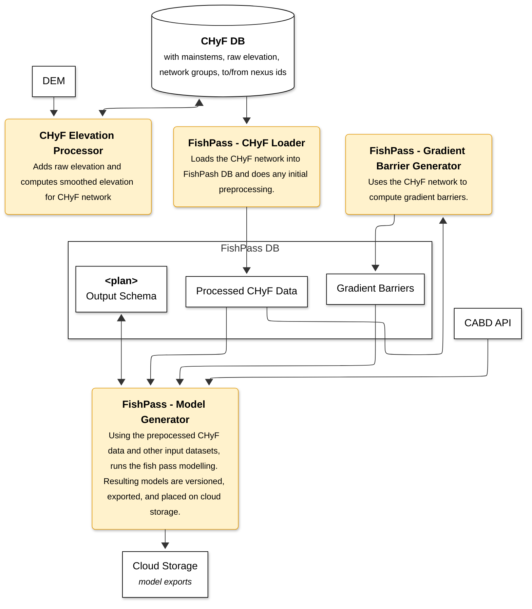

# fishpass
Fish passage and connectivity modelling for Canadian watersheds

FishPass models how barriers -- dams, culverts, waterfalls, and other natural or anthropogenic
structures -- limit fish species from reaching habitat throughout a stream network. Given a
stream network, a catalogue of barriers, and per-species/lifestage passability parameters, it
computes which stream segments are naturally accessible to which species, and the resulting
habitat and upstream-length statistics per species/lifecycle. Runs are scoped to one or more
AOIs (work units) and executed via GitHub Actions against a shared PostgreSQL database.

The pipeline has three components, run in order:

1. **[chyf_loader](chyf_loader/README.md)** -- Copies the CHyF2 stream network into the FishPass
   database's `chyf_raw` schema, flags isolated stream segments, and computes segment length.
2. **[gradient_barriers](gradient_barriers/README.md)** -- Computes gradient barriers per fish
   species/lifestage from the cached CHyF stream network and writes them to
   `support.gradient_barriers`. Requires chyf_loader to have already run.
3. **[fishpass_engine](fishpass_engine/README.md)** -- Runs a model plan end-to-end: loads the
   stream network, barriers, and habitat data for the plan's AOI, applies structure/habitat
   updates, snaps everything onto the network, and computes per-species/lifecycle accessibility,
   habitat, and upstream-length statistics. It then ranks barriers per species/lifecycle and
   rebuilds the plan's WCRP combined output view. Requires chyf_loader (and gradient_barriers,
   if the plan uses gradient barriers) to have already run.

## FishPass Architecture 


## Development

Code formatting and linting are handled by [ruff](https://docs.astral.sh/ruff/), pinned in
`pyproject.toml`. Install it with:

```bash
pip install --group dev
```

(requires pip 25.1+; on an older pip, install the pinned version directly with
`pip install ruff==0.16.8` instead).

Then, from the repo root:

```bash
ruff format .   # format all files
ruff check .    # lint all files
```

A [pre-commit](https://pre-commit.com/) hook is configured to run both automatically on
`git commit`, only against staged files. After installing the dev dependencies, enable it once
per clone with:

```bash
pre-commit install
```
