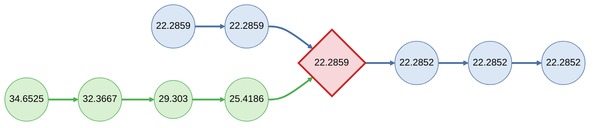

# FishPass - Gradient Barrier Generator

Using the 4d CHyF network and fish pass parameters files, this computes gradient barriers per species and lifestage.

This is a python script.

## Running

This is run via a GitHub action, triggered by `workflow_dispatch` (manual), matching the `chyf_loader` reload action.

## Inputs

* Fishpass cached CHyF network with elevation and smoothed elevation.
  * This network is loaded from the chyf_raw.flowpath table.  These are all 4-d geometries, with the smoothed elevation being stored in the 4th dimension, the **M ordinate** (XYZM/XYM).
  * Every flowpath LineString is digitized consistently network-wide, starting at its **upstream** end and ending at its **downstream** end. The mainstem_seq attribute orders the edges along the mainstem with 1 representing the most downstream edge and values increasing as you walk up the mainstem.

* Fish species parameter file from GitHub.
  * This file identifies the gradient threshold for each species and life stage.
  * Complete details of this file are documented in docs/fish_species_parameter_file.md
  * Located at `config/fish_species_parameters.yaml` in this repo, read directly from the checked-out repo at runtime (no external fetch).

* Configuration File (`config/gradient_barriers.yaml`)
  * Contains the `barrier_offset_m` setting and workunit filters.

* Database Connection
  * The database connection reuses the same `FISHPASS_HOST/PORT/DBNAME/USER/PASSWORD` environment variable / GitHub secrets convention as `chyf_loader` — connection details are never stored in config files and never logged.

## Outputs

Gradient barriers are computed at all locations where the gradient is greater than the maximum gradient defined in the fish species parameter files.

* The `accessibility_gradient_spawning_max` and `accessibility_gradient_rearing_max` attributes are used for gradient limits
* Each barrier is flagged with the species and lifecycles (spawn, rear) they are barriers for. A single point can be a barrier for any number of species/lifecycles.

**Table: support.gradient_barriers**

Each run creates a new set of output tables, however existing tables are renamed `support.gradient_barriers_archive_<yyyymmdd>_<seq>`, to prevent losing manual updates. The `seq` is incremented if today's archive name is already taken. This full-table archive/recreate only happens on an unscoped (whole-network) run -- see "AOI-scoped reprocessing" below for the alternative when only one or a few AOI(s) are being redone.

| Column | Type | Description |
| :---- | :---- | :---- |
| id | uuid | Unique system generated id |
| geometry | point | Location of barrier, `barrier_offset_m` upstream of the measured vertex (see [Barrier Placement](#barrier-placement)). |
| workunit | varchar[] | The workunit the barrier point (`geometry`) falls in (if on the boundary of work units, record both). Used by the FishPass engine to select barriers for a model run. |
| downstream_geometry | point | Location of the measured (downstream) vertex the gradient was computed from. |
| downstream_workunit | varchar[] | The workunit the measured vertex (`downstream_geometry`) falls in (if on the boundary of work units, record both). Used by AOI-scoped reprocessing to select the rows to replace. |
| gradient | double | Computed gradient value. |
| computed_species | string[] | List of fish species/lifestage that this barrier applies to. These are encoded as \<species\>\_\<lifestage\> (ex. as_rear, as_spawn). |
| actual_species | string[] | Used for modelling, this is a copy of the computed_species but allows users to overwrite.  Further details are in the FishPass Process input description. For the purposes of the barrier computation, this is always populated with the same value as the computed_species. |
| comments | varchar | Placeholder for user comments. |

**Table: support.gradient_barriers_metadata**

Records the AOI scope, the fish species parameters in effect, the barrier offset, and the run's timestamp.

On a full (unscoped) run, any existing table is archived to `support.gradient_barriers_metadata_archive_<yyyymmdd>_<seq>` (same convention as support.gradient_barriers) before a fresh table is created and a single row inserted with aoi = {all}.

On an AOI-scoped run, no archiving happens -- a row is simply appended identifying the AOI(s) being reprocessed, so metadata history from prior runs is preserved.

| Column | Type | Description |
| :---- | :---- | :---- |
| id | uuid | Unique system generated id |
| aoi | varchar[] | {all} for a full (unscoped) run, or the reprocessed chyf_raw.aoi short_name(s) for a scoped run. |
| species_params | jsonb | Snapshot of the fish species/lifestage gradient parameters in effect for this run. |
| barrier_offset_m | double | Distance (m) upstream of the measured vertex at which barriers were placed for this run (see [Barrier Placement](#barrier-placement)). |
| run_at | timestamp | When this run completed. |

## Process

Gradients are computed at each vertex along the stream network — every coordinate vertex in each flowpath LineString geometry, not just edge endpoints. The smoothed elevation at that point and a point on the stream network 100m upstream on the same mainstem are used to determine gradient.

If a vertex doesn't have 100m of upstream length remaining within its own edge, the walk continues into the next edge upstream on the same `mainstem_id` (ordered by ascending `mainstem_seq`). If the mainstem runs out (reaches its most-upstream edge) before accumulating 100m, that vertex has no gradient, same as a vertex with no upstream point at all.

The upstream reference elevation at the 100m mark is linearly interpolated between the two vertices whose segment contains the point exactly 100m upstream, rather than using the elevation of whichever vertex happens to be first at or beyond 100m — using the nearest vertex instead would average the gradient over whatever the actual distance to that vertex turns out to be, diluting real local steepness in sparse-vertex reaches.

Stream vertices with no upstream point do not have a gradient.

Vertices with a missing smoothed elevation -- the `-9999` no-data sentinel used in chyf_raw, or `NaN` -- are skipped: they never produce a barrier and never act as an upstream/downstream reference elevation for another vertex's gradient. Distance still accumulates through a skipped vertex as normal (it doesn't depend on elevation), and the nearest valid vertex on either side remains the reference elevation used to interpolate across the gap, so a stretch of missing data doesn't otherwise interrupt the walk. Each run logs a count of how many vertices were skipped this way.

A vertex whose gradient doesn't exceed *any* species/lifestage threshold produces no row at all in support.gradient_barriers -- it is not written with an empty computed_species.

For the purposes of this script, the `actual_species` output field is the same as the `computed_species`.

The `workunit` and `downstream_workunit` fields record the short_name from the chyf_raw.aoi table (linked to the chyf_raw.flowpath table via the aoi_id), assigned as a post-processing spatial join (`geometry` and `downstream_geometry` respectively vs. `chyf_raw.aoi` polygons) after barrier points are inserted, rather than trusting a single flowpath edge's `aoi_id` — this correctly captures points that fall on/near a boundary between workunits.

Two workunit columns are needed because the barrier point can be up to `barrier_offset_m` upstream of the measured vertex, and so can fall in a different workunit. `workunit` describes where the barrier is, which is what a model run needs. `downstream_workunit` describes which workunit's scoped run produces the barrier, which is what AOI-scoped reprocessing needs (see below).

### Barrier Placement

A barrier is not written at the measured vertex itself, but `barrier_offset_m` metres upstream of it along the same mainstem (configured in `config/gradient_barriers.yaml`, between 0 and 100, default 100). The location is linearly interpolated between the two walked vertices whose segment contains that point (including vertices with missing elevation, since their position is still valid). Gradient values are unaffected by this setting.

This matters at confluences: the most-downstream vertex of a tributary mainstem is the confluence point it shares with the receiving stream, so a barrier placed there would also block the receiving stream. Moving it upstream keeps it on the tributary whose gradient produced it. Setting `barrier_offset_m: 0` places barriers at the measured vertex. See [Barriers at Confluence Points](#barriers-at-confluence-points) for the background and considerations behind this decision.

## AOI-scoped reprocessing

Optionally, a run can be scoped to just one or a few AOI(s) instead of the entire network, via `workunits` in `config/gradient_barriers.yaml` (see README.md). This is unset/empty by default, meaning "recompute everything" (unchanged default behavior).

When AOI(s) are configured, the script:

1. Resolves the requested `short_name`(s) against `chyf_raw.aoi`, exiting if any don't resolve (typo protection).
2. Backs up the existing `support.gradient_barriers` rows whose `downstream_workunit` overlaps the requested AOI(s) to `support.gradient_barriers_aoi_backup_<yyyymmdd>_<seq>` (`seq` is incremented if today's name is already taken), then deletes them from the live table. If `support.gradient_barriers` doesn't exist yet, it's created (empty) instead of erroring out — a scoped run doesn't require a full run to have happened first. If the existing table predates the `downstream_geometry`/`downstream_workunit` columns, the run exits and a full run must be done first.
3. Recomputes barriers, walking every edge of any mainstem that has at least one edge in the requested AOI(s) -- including edges in neighboring AOIs -- but only caching/inserting barriers for measured vertices whose own edge's `aoi_id` is in the requested AOI(s).
4. Runs the same `workunit`/`downstream_workunit` spatial-join assignment as a full run (scoped to rows where they are `NULL`, i.e. just-inserted rows).

Rows are deleted by `downstream_workunit` rather than `workunit` so that a barrier is always deleted and recreated by the same scoped run. Both steps 2 and 3 are based on the measured vertex, even when the barrier point itself was placed across a workunit boundary. Selecting by `workunit` instead would let a scoped run delete barriers it doesn't recreate (losing them), or recreate barriers it didn't delete (duplicating them).

Because a vertex's gradient depends on the point 100m upstream *on the same mainstem*, which can lie in a neighboring AOI, step 3's edge fetch (`fetch_edges`) pulls every edge of any mainstem that has at least one edge in the requested AOI(s) — including the portions of that mainstem that fall in neighboring AOIs — so the 100m walk stays correct across the boundary. Each edge's own `aoi_id` (also returned by `fetch_edges`) then decides, per edge, whether its vertices are eligible to produce a barrier: an out-of-scope edge's vertices are still walked (keeping distance/elevation state correct for later vertices) but are never cached or inserted as barriers. This means points belonging to a neighboring AOI that happens to share a mainstem are computed internally but never written, rather than being inserted and then deleted.

**Caveat when `chyf_raw.aoi` polygon boundaries change:** step 2's backup/clear step selects existing rows to remove by their previously-assigned `downstream_workunit` value, not by re-testing their `downstream_geometry` against the current AOI polygons. If an AOI's boundary is redrawn, an AOI-scoped run for it does not necessarily clear and recompute the barriers near the old boundary line correctly, and the table can end up inconsistent between barriers computed under the old boundary and ones computed under the new one. When AOI boundaries change, either recompute the entire network (a full, unscoped run), or manually update the `downstream_workunit` column on the affected existing rows to reflect the new boundaries before running an AOI-scoped reprocess.

**Caveat for measured vertices on a workunit boundary:** a measured vertex that lies exactly on the boundary between two workunits (for example, the shared end vertex of two edges in different AOIs) intersects both AOI polygons, so its row gets both short_names in `downstream_workunit` (e.g. `{A,B}`). However, step 3 only recreates the barrier from one of them: the AOI of the edge the vertex was walked on. In a scoped run of the *other* AOI, step 2 deletes the row (its `downstream_workunit` overlaps) but step 3 doesn't recreate it, so the barrier is lost until a full run or a scoped run of the owning AOI. This is uncommon, since it needs a barrier measured from exactly a boundary vertex. To avoid it, reprocess neighbouring workunits together (list both in `workunits`), or do a full run.

## Architectural Decisions

* Since the FishPass Postgres server is a shared/production resource, the 100m-walk and gradient computation is done in Python (not as large SQL window-function/LATERAL queries in Postgres) to avoid loading the database server. SQL is used only to extract raw edge geometries and to perform final table/workunit bookkeeping. Geometry parsing (including the M ordinate) uses `shapely>=2.1` with `GEOS>=3.12`, which is required for reliable M-ordinate support.
* Edges are read via a named/server-side psycopg cursor (`fetch_edges`), so `chyf_raw.flowpath` is streamed from Postgres in batches rather than loaded into client memory all at once. Resolved barriers are cached in a plain in-memory list as `compute_barriers` walks the network; once that cache exceeds `BARRIER_CACHE_SIZE` (5,000) rows it's written to `support.gradient_barriers` via `insert_barriers` and cleared, and the walk continues. A full-network run can produce far more edges and barrier points than comfortably fit in memory at once, so neither the complete edge set nor the complete barrier set is ever held in memory simultaneously. The edge cursor is opened `WITH HOLD` so it survives across commits (see below) while it's still being iterated.
* The run commits in stages rather than as one single all-or-nothing transaction: once after the table is prepared/archived (or, for an AOI-scoped run, once after the existing rows for that AOI are backed up and cleared), and then again after every `insert_barriers` batch flush. This keeps each transaction (and its WAL footprint) bounded to roughly one batch of work instead of growing across the entire run. The trade-off is that a run which fails partway through no longer leaves the table exactly as it was before the run started -- for a full run, the old table has already been archived and the new one is left partially populated; for an AOI-scoped run, the target AOI(s) are left with only the barriers computed before the failure. A re-run (full or AOI-scoped, as appropriate) is expected to be used to recover from a failed run, rather than relying on the failed run having left the table untouched.

## Design Decision

### Volume of Gradient Barriers

In steeper terrain this process will generate a gradient barrier at every qualifying vertex along the stream network, which can produce a large number of barriers. This was discussed with the team and, for now, this behavior is required: if local or other knowledge identifies that a small section of stream is not actually steep, or that fish have another way to pass a given point, we need to know the next upstream barrier. If this volume of barriers turns out to be inefficient for the process, we discussed potentially thinning the output to flag barriers only every ~500m as a mitigation. More sophisticated approaches (e.g., identifying actual changes in slope while walking upstream, to only flag the start of a steep section) are out of scope for this work but may be investigated in the future.  The other suggestions of one barrier per mainstem or per connected group were rejected.

### Barriers at Confluence Points

<https://github.com/Canadian-Wildlife-Federation/fishpass/issues/42>

Originally the gradient barriers were placed at the downstream vertex of 100m stretch of stream segment being tested. This resulted in gradient barriers being placed at confluences and acting as barriers to both tributaries when only a single tributary had a steep section.

In this example:

* Node labels are smoothed elevations (m)
* flow is left to right.
* green nodes are one mainstem, blue nodes are a second mainsteam
* red diamond is the confluence point where they meet.

The gradient point created at the confluence (red diamond) is a result of the gradients along the green mainstem. During analysis the gradient barriers are treated as barriers for everything upstream (in this case both the green stream and the blue stream upstream of that point), when in this example it should only be a barrier for the green stream. The same would be true if the green stream was flat and the blue stream had a steep area at that point. The gradient barrier would be generated at the point because the blue stream was steep, but during analysis it would act as a barrier for both streams.

The decision was to move the gradient barriers upstream from the downstream vertex, controlled by the `barrier_offset_m` setting (see [Barrier Placement](#barrier-placement)). This has the following considerations:

* The vertex snap distance (`structure_snap_vertex_distance_m`) must be smaller than the barrier offset (`barrier_offset_m`), otherwise the gradient barriers may just be snapped back to the confluence point during processing.
* The habitat upstream and downstream lengths will be adjusted by the barrier offset. Each gradient barrier now sits `barrier_offset_m` further upstream than before. The habitat length downstream of each barrier increases by up to that amount, and the length upstream of it decreases by the same amount.
* With the default of 100 m, the barrier sits at the top of the steep 100 m stretch, so the model treats that steep stretch as accessible. A smaller offset is possible by adjusting the `barrier_offset_m` in the configuration.

**Alternative Option (considered & rejected)** - The other option explored was to associate each barrier with an edge as well as a vertex. The fishpass engine would use both the edge and the vertex to determine what flowpaths act as barriers. This would require more substantial changes to the software and would require barriers to be regenerated/remapped if flowpath edge ids changed.
